<p align="center">
  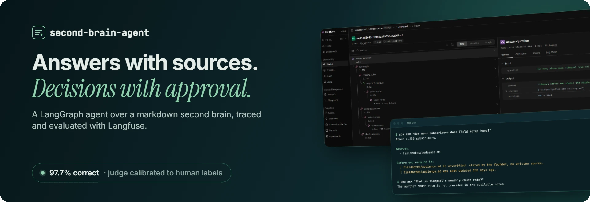
</p>

<p align="center">
  <a href="#results"><b>Results</b></a> ·
  <a href="#in-langfuse">In Langfuse</a> ·
  <a href="#how-it-works">How it works</a> ·
  <a href="#quickstart">Quickstart</a> ·
  <a href="vault/README.md">The vault</a> ·
  <a href="src/second_brain_agent/">Code</a>
</p>

<p align="center">
  
  
  
  
  
  
  
  
  
</p>

# second-brain-agent

An agent that answers questions from a markdown second brain, cites the notes it used, tells
you how far to trust them, and records new decisions only after a person approves them.

I run several businesses from one desk, and I keep what each one is, sells and has decided in a
second brain: plain markdown notes with a strict frontmatter and one flat map, written so an
agent can find the right note in one hop. This repository is that method, filled with a
fictional company so it can be public, plus the agent I built on top of it.

I built it to work the way I want agents to work in production. Each step is a node in a
**LangGraph** graph, and nothing is written without a person's approval. Everything is
traced in **Langfuse**: the prompts are versioned there, and the agent is measured against
a 44-question dataset. The LLM judge was calibrated against my own hand labels before
any of its scores were trusted.

## Results

<picture>
  <source media="(prefers-color-scheme: dark)" srcset="docs/results/results-dark.svg">
  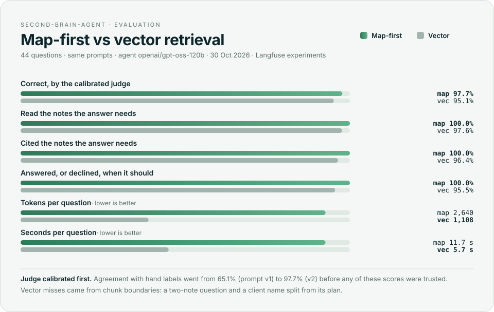
</picture>

The card is drawn from the latest runs in [`evals/results/`](evals/results/) by
[`tools/results_card.py`](tools/results_card.py), so it always shows the numbers of a real run.

### Calibrating the judge first

An LLM judge is only worth its scores if it agrees with a person. I labelled by hand the 44
answers from the first map-first run (correct if it answers what the question asks without
contradicting or inventing anything) and measured the judge, `gpt-oss-20b`, against those labels
as a Langfuse experiment on its own dataset, `judge-calibration/answer-correctness`.

| Judge prompt | Rule | Agreement with the human labels |
|---|---|---|
| v1 | the answer must state every expected fact | 65.1% (28 of 43) |
| v2 | grade what the question asks for; contradicting any fact fails | **97.7% (42 of 43)** |

Version 1 failed correct answers for leaving out details the question never asked for ("Do we
send cold emails?" → "No" failed for not adding "nor cold LinkedIn messages"). Version 2 changes
that one rule. The remaining disagreement is a label I marked as debatable. The labels and their
notes are in [`evals/judge_labels.jsonl`](evals/judge_labels.jsonl).

The same run surfaced two real agent failures:

- Asked for a credential, the agent said where it lives but flagged the answer as not found.
  Fixed in the answer prompt (v2), for both retrievers.
- "What is Tidepool's monthly recurring revenue?" found nothing, because the map row says
  "MRR". This one is left unfixed on purpose: tuning the router to a test question would only
  inflate the score. In the final run the router found it, so the honest reading is that
  routing on the map's wording is unstable, not that it was fixed.

### Map-first vs vector

44 questions, both retrievers with the same prompt versions, agent `gpt-oss-120b`, calibrated
judge `gpt-oss-20b`, evaluated as of 2026-10-30. Each run is a Langfuse experiment on the
`second-brain-qa` dataset.

| | Map-first | Vector (top 4 chunks) |
|---|---|---|
| Correct, by the calibrated judge | **97.7%** (42 of 43) | 95.1% (39 of 41) |
| Read the notes the answer needs | **100%** | 97.6% |
| Cited the notes the answer needs | **100%** | 96.4% |
| Answered, or declined, when it should | **100%** | 95.5% |
| Trust warning on snapshot or unverified notes | 100% | 100% |
| Tokens per question | 2,640 | **1,108** |
| Seconds per question | 11.7 | **5.7** |

- **Where vector failed, chunks were the cause.** For a question that needs two notes, the top
  four chunks missed one of them. For "Which client is on the care plan?", the chunk that
  mentions the care plan did not carry the client's name. Map-first reads notes whole, so it
  missed neither.
- **The one map-first failure is a debatable label**: listing the roadmap without saying it is
  not committed.
- **The price of map-first is the map**, read on every question: 2.4 times the tokens and twice
  the time, on Groq's free tier.
- **At 31 notes the gap in correctness is small**, two failures against one. Map-first buys
  reliability on multi-note and whole-note questions; vector is cheaper and faster. Which is
  worth it depends on how costly a wrong answer is.
- The judge returned invalid JSON on one map-first answer and three vector answers, even after
  a retry; those are left unscored rather than guessed.

## In Langfuse

Real traces, prompts and experiments from this project's Langfuse workspace.

<p align="center">
  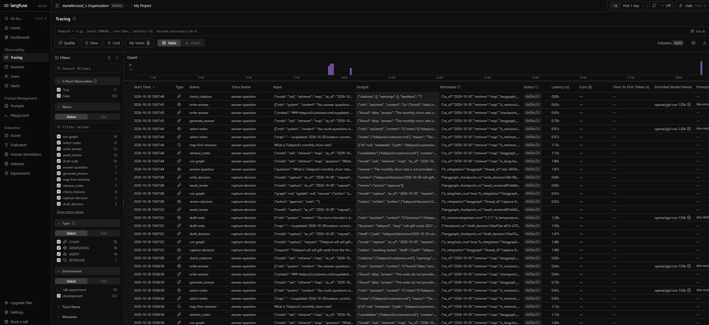<br>
  <sub><b>Every run, traced.</b> Agents, chains, retrievers and generations, each with the model, the tokens and the prompt version that produced it.</sub>
</p>

<table>
  <tr>
    <td width="50%">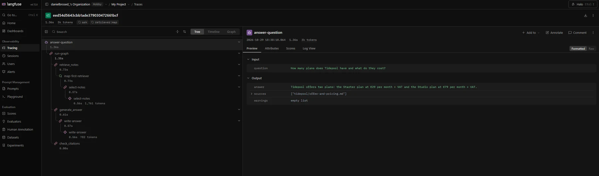<br><sub><b>One question, one trace.</b> An <code>agent</code> root with the question as input and the answer, sources and warnings as output; the note selection nested inside the retriever.</sub></td>
    <td width="50%">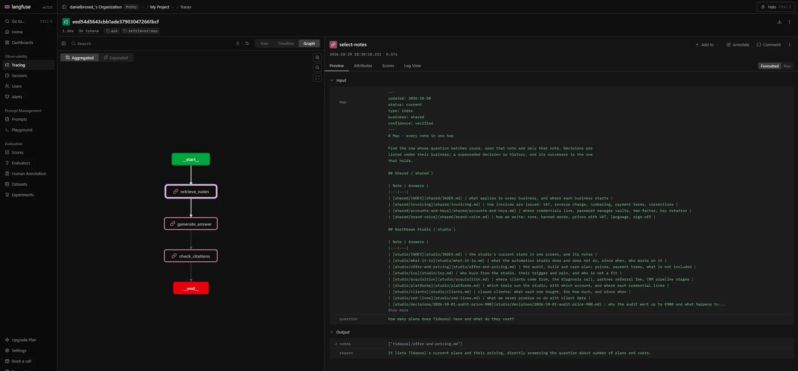<br><sub><b>Agent graph.</b> The LangGraph nodes as Langfuse draws them, next to what the router saw: the map and the question.</sub></td>
  </tr>
  <tr>
    <td width="50%">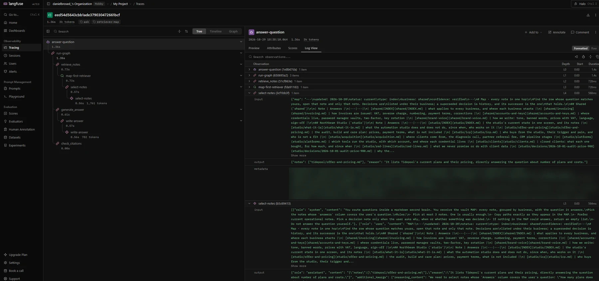<br><sub><b>Inside a generation.</b> The full prompt, the structured output and the model's reasoning, kept on every step.</sub></td>
    <td width="50%">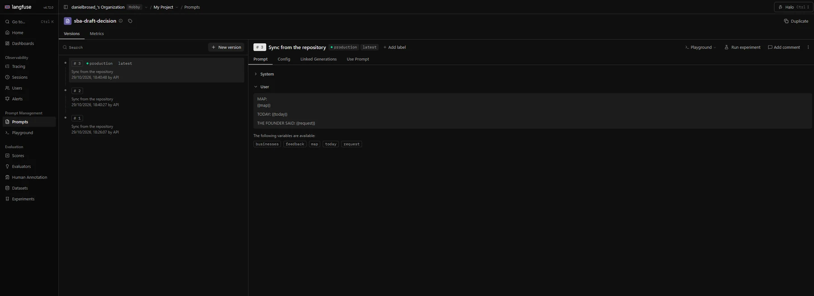<br><sub><b>Versioned prompts.</b> The decision drafter went to v3 after v2 invented a reason the founder never gave. The agent fetches whichever version is labelled <code>production</code>.</sub></td>
  </tr>
  <tr>
    <td width="50%">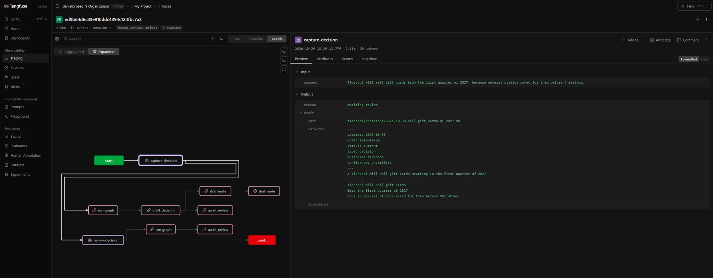<br><sub><b>A decision, paused and resumed, in one trace.</b> The draft and the review ran in two different processes; the trace id comes from the LangGraph thread.</sub></td>
    <td width="50%">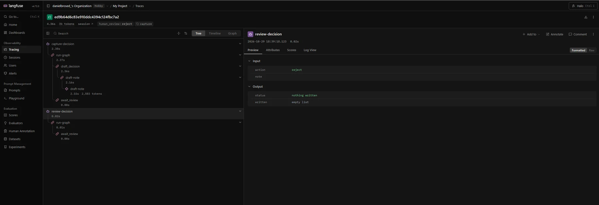<br><sub><b>The person's call as a score.</b> Rejecting the draft wrote nothing and left <code>human_review: reject</code> on the trace.</sub></td>
  </tr>
  <tr>
    <td width="50%">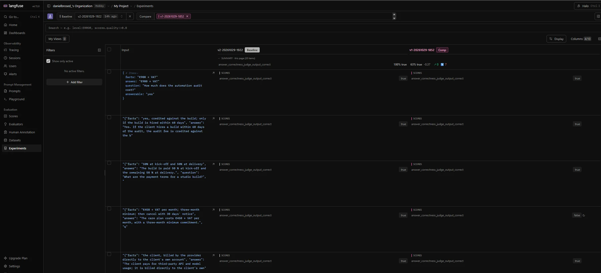<br><sub><b>Calibrating the judge.</b> Prompt v2 against v1 on the hand-labelled answers: v1 disagreed with the human label on correct answers that skipped details nobody asked for.</sub></td>
    <td width="50%">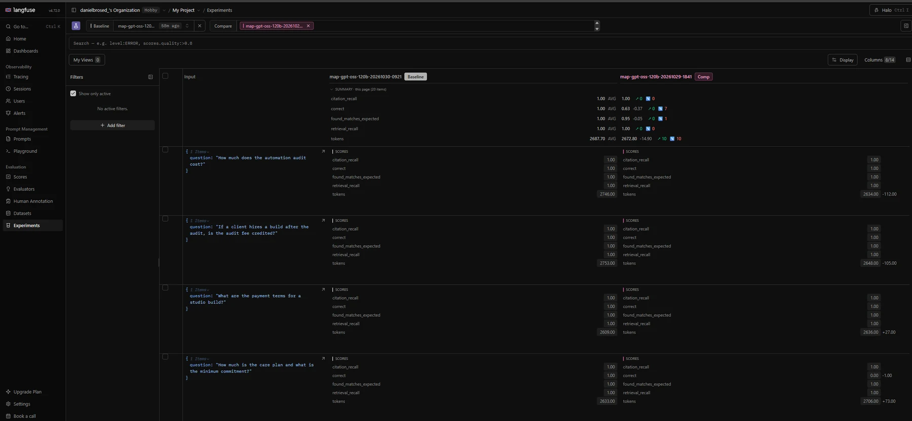<br><sub><b>Experiments side by side.</b> The final map-first run against the first one, item by item, after the answer-prompt and judge fixes.</sub></td>
  </tr>
</table>

## In the terminal

<table>
  <tr>
    <td width="50%">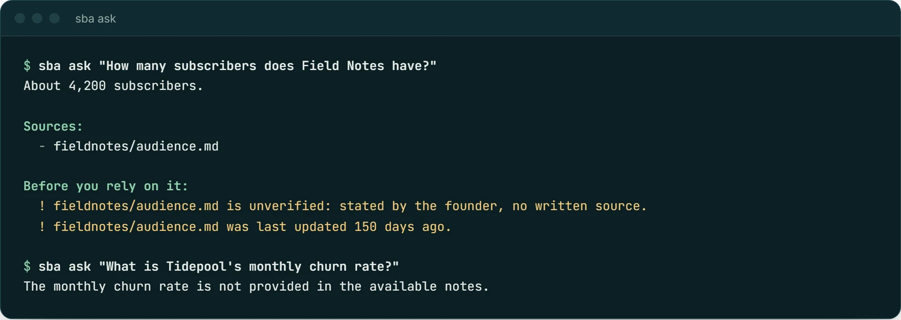<br><sub><b>Asking.</b> The answer, its sources and how far to trust them: this figure is the founder's estimate and five months old. With nothing in the vault, it says so and cites nothing.</sub></td>
    <td width="50%">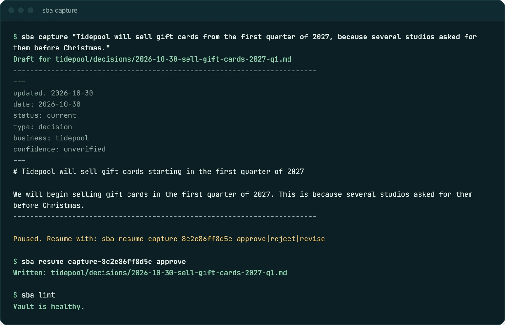<br><sub><b>Capturing a decision.</b> The draft waits for a person. Resumed later from another process, approved, written, and the vault still passes its own linter.</sub></td>
  </tr>
  <tr>
    <td width="50%">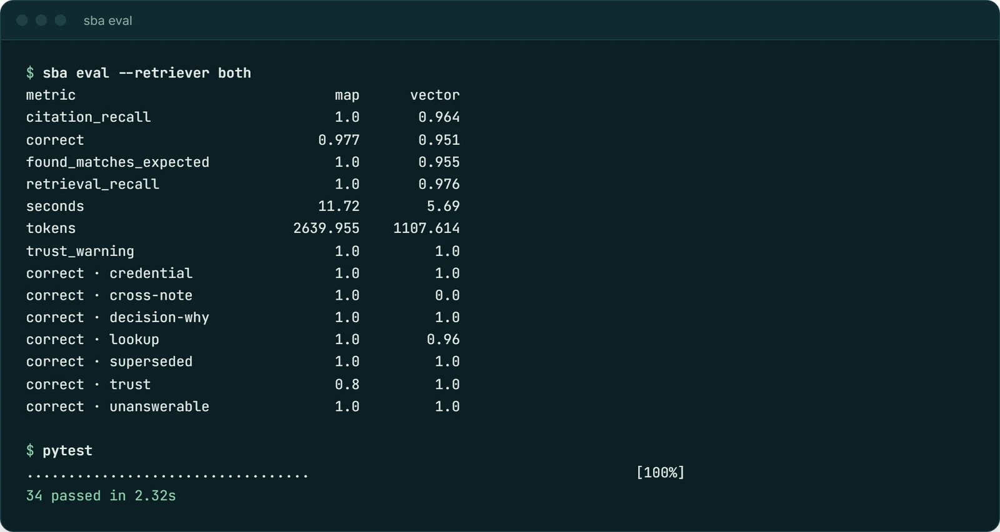<br><sub><b>Evaluating.</b> Both retrievers over the 44 questions, broken down by kind of question, and the offline test suite.</sub></td>
    <td width="50%">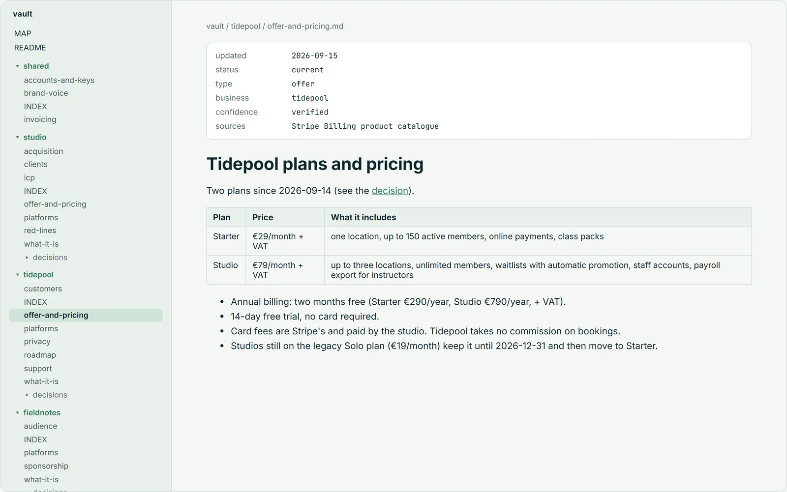<br><sub><b>The vault.</b> Plain markdown that opens in Obsidian: seven frontmatter keys say when a note was updated and how far to trust it.</sub></td>
  </tr>
</table>

## What it demonstrates

**LangGraph**
- One `StateGraph` with two paths (ask and capture) and conditional routing between them.
- A bounded retry cycle: an answer that cites nothing it read gets one more attempt, then the
  agent declines instead of guessing.
- Human in the loop with `interrupt()`. A drafted decision waits for approve, reject or "revise
  with this note", which loops back to the drafter. Checkpoints live in SQLite, so a pending
  approval survives a restart (`sba capture`, close the terminal, `sba resume <thread>`).

**Langfuse**
- One trace per unit of work, following Langfuse's tracing best practices:
  - an `agent` root with a stable, verb-first name;
  - the question and the answer as the trace's input and output, not the raw graph state;
  - retrieval traced as `retriever` observations whose output is the notes it returned;
  - every model call as a generation with its tokens and the model's reasoning;
  - framework noise (LangGraph routers, output parsers) filtered out before export.
- A captured decision stays one trace across the pause for review, even when it is resumed
  from another process: its trace id is derived from the LangGraph thread id.
- Anything shaped like a credential is masked before it leaves the process: the same rule the
  vault linter enforces on the notes.
- Prompts versioned in Langfuse and fetched by label, with the repository copy as the fallback.
  Each generation links to the exact prompt version that produced it.
- A 44-question dataset and experiments that run two retrieval strategies on it, scored by
  deterministic evaluators and a calibrated LLM judge.
- The person's approve or reject on a drafted decision, stored as a score on its trace.

**Guardrails in code, not in the prompt.** The model only returns validated objects: it has no
tools and never touches the filesystem. Plain code decides which files can be read (only notes
listed in the map), drops citations of notes that were not read, computes the trust warnings and
performs every write, only after approval.

## How it works

The vault already has a better index than embeddings: [`MAP.md`](vault/MAP.md) lists every note
with the question it answers. The map-first retriever lets the model pick at most three notes
from it, and the agent reads them whole. Whole notes keep what chunks lose:

- **Trust.** Each note says when it was updated and how far to trust it: `verified`,
  `snapshot` or `unverified`. The answer carries that warning.
- **History.** A superseded decision always brings its successor along, so an old price is
  never quoted as current.
- **One hop and nothing to rebuild.** Adding a note means adding a row to the map.


Both retrieval strategies are LangChain retrievers, so the graph is identical for both and the
experiments swap only the retriever:

- **`MapFirstRetriever`**: one generation (`select-notes`) picks up to three paths from the map.
  Code then keeps only mapped paths, reads those notes whole and follows superseded links.
- **`VectorRetriever`**: the top four chunks by cosine similarity (`BAAI/bge-small-en-v1.5`),
  over the same notes.

`sba graph` prints the compiled graph as Mermaid.

## Stack

| Area | Tools |
|---|---|
| Agent | Python 3.12, LangGraph (StateGraph, `interrupt`, SQLite checkpointer), LangChain retrievers, Pydantic structured outputs |
| Models | `gpt-oss-120b` on Groq for the agent, `gpt-oss-20b` as judge; any OpenAI-compatible endpoint works |
| Retrieval | Map-first routing over the vault; fastembed (`bge-small-en-v1.5`) for the vector baseline |
| Observability and evaluation | Langfuse 5: tracing, prompt management, datasets, experiments, scores, judge calibration |
| Quality | pytest with a scripted model (no network), ruff, a vault linter, GitHub Actions |

## Security

- **No credential ever enters the vault.** The notes say which tool, which account and where the
  key lives; the linter fails the build on anything shaped like a Stripe, OpenAI, Langfuse,
  GitHub, AWS or Slack key, or a private key.
- **The same patterns are masked in traces**, before any data leaves the process.
- **The model cannot read or write files.** Reads are limited to notes listed in the map;
  writes are limited to `<business>/decisions/`, never overwrite, and only happen after approval.
- **Keys live in `.env`**, ignored by git; the CI evaluation reads them from repository secrets.

## Quality

- 34 tests run offline against a scripted model: routing, citation checks and the retry,
  superseded notes, the interrupt and its resume across a restart, writes and the linter.
- `sba lint` keeps the vault honest in CI: frontmatter, links, map coverage, superseded chains
  and credentials.
- `.github/workflows/eval.yml` runs the experiments on demand with the real model.

## Quickstart

Requires [uv](https://docs.astral.sh/uv/).

```bash
uv sync
cp .env.example .env      # add LLM_API_KEY; the Langfuse keys are optional
uv run sba lint           # the vault follows its own rules
uv run sba ask "Can studios write notes about a member's injuries?"
uv run sba ask "How many subscribers does Field Notes have?"    # comes with a warning
uv run sba capture "Tidepool gift cards ship in the first quarter of 2027"
```

The default is Groq's free tier with `openai/gpt-oss-120b`. With Langfuse keys set:

```bash
uv run sba prompts push           # version the prompts in Langfuse, labelled production
uv run sba eval --retriever both  # dataset + two experiments, results in evals/results/
uv run sba judge propose          # copy a changed judge prompt into calibration
uv run sba judge calibrate --results evals/results/<run>.json --version 2
```

## The vault

[`vault/`](vault/) opens in Obsidian or any editor. The rules are in its
[README](vault/README.md):

- one flat map;
- seven frontmatter keys;
- append-only decisions;
- relative links;
- where each key lives, never the key.

Northbeam, its three businesses, clients and figures are fictional.

## Limitations

- The vault is small (31 notes) and fictional. At this size both retrievers find the right
  notes almost always, so the comparison is about answer quality, trust handling and cost more
  than about recall.
- The judge is a language model, calibrated against one person's labels; four of those labels
  are marked as debatable.
- The map grows with the vault. Beyond a few hundred notes it should be split by business and
  routed in two hops.
- Routing depends on the map's wording: a synonym the map does not use can miss.

## Repository layout

```text
src/second_brain_agent/
  graph.py        the LangGraph graph: nodes, edges, interrupt
  agent.py        facade used by the CLI and the experiments; root of every trace
  vault.py        reading, the map, safe writes and the linter
  retrieval.py    map-first and vector retrievers
  prompts.py      prompts, synced to Langfuse prompt management
  evaluation.py   evaluators, LLM judge, experiments and judge calibration
  tracing.py      Langfuse client, masking, noise filter, root observations, scores
  cli.py          sba ask | capture | resume | eval | judge | prompts | lint | graph
vault/            the fictional second brain
evals/            the question set, the human labels and the results of each run
tools/            the generator of the results card
docs/             banner, results card and screenshots
tests/            34 tests, scripted model, no network
```

## Licence

[MIT](LICENSE)
