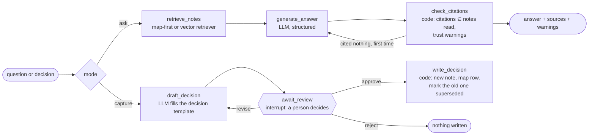

# second-brain-agent

An agent that answers questions from a markdown second brain, cites the notes it used, tells
you how far to trust them, and records new decisions only after a person approves them.
Built with **LangGraph**, traced and evaluated with **Langfuse**.

The vault is the method I use to run my own businesses, filled here with a fictional company
so it can be public.

## What it demonstrates

**LangGraph**
- One `StateGraph` with two paths (ask and capture) and conditional routing between them.
- A bounded retry cycle: an answer that cites nothing it read gets one more attempt, then the
  agent declines instead of guessing.
- Human in the loop with `interrupt()`. A drafted decision waits for approve, reject or "revise
  with this note", which loops back to the drafter. Checkpoints live in SQLite, so a pending
  approval survives a restart (`sba capture`, close the terminal, `sba resume <thread>`).

**Langfuse**
- One trace per unit of work, following Langfuse's tracing best practices:
  - an `agent` root with a stable, verb-first name;
  - the question and the answer as the trace's input and output, not the raw graph state;
  - retrieval traced as `retriever` observations whose output is the notes it returned;
  - every model call as a generation with its tokens.
- A captured decision stays one trace across the pause for review, even when it is resumed
  from another process: its trace id is derived from the LangGraph thread id.
- Anything shaped like a credential is masked before it leaves the process: the same rule the
  vault linter enforces on the notes.
- Prompts versioned in Langfuse and fetched by label, with the repository copy as the
  fallback. Each generation links to the exact prompt version that produced it.
- A 44-question dataset and experiments that run two retrieval strategies on it, scored by
  deterministic evaluators and an LLM judge.
- The person's approve or reject on a drafted decision, stored as a score on its trace.

**Guardrails in code, not in the prompt.** The model only returns validated objects: it has no
tools and never touches the filesystem. Plain code decides which files can be read (only
notes listed in the map), drops citations of notes that were not read, computes the trust
warnings and performs every write, only after approval.

## The idea: map-first retrieval

The usual approach to "chat with your notes" is to chunk them, embed the chunks and retrieve
the nearest ones. This vault already has a better index: [`MAP.md`](vault/MAP.md) lists every
note with the question it answers. The router reads the map, picks at most three notes and
the agent reads them whole.

Reading whole notes keeps what chunks lose:

- **Trust.** Each note says when it was updated and how far to trust it: `verified`,
  `snapshot` or `unverified`. The answer carries that warning.
- **History.** A superseded decision always brings its successor along, so an old price is
  never quoted as current.
- **One hop and nothing to rebuild.** Adding a note means adding a row to the map.

The cost is the map itself, read on every question. The experiments measure whether that
trade is worth it against a standard embedding retriever (`BAAI/bge-small-en-v1.5`, top 4
chunks) over the same notes.

## How it works



Both retrieval strategies are LangChain retrievers, so the graph is identical for both and the
experiments swap only the retriever:

- **`MapFirstRetriever`**: one generation (`select-notes`) picks up to three paths from the map.
  Code then keeps only mapped paths, reads those notes whole and follows superseded links.
- **`VectorRetriever`**: the top four chunks by cosine similarity, over the same notes.

`sba graph` prints the compiled graph as Mermaid.

## Results

Results of the first full run go here.

## Quickstart

Requires [uv](https://docs.astral.sh/uv/).

```bash
uv sync
cp .env.example .env      # add LLM_API_KEY; the Langfuse keys are optional
uv run sba lint           # the vault follows its own rules
uv run sba ask "Can studios write notes about a member's injuries?"
uv run sba ask "How many subscribers does Field Notes have?"    # comes with a warning
uv run sba capture "Tidepool gift cards ship in the first quarter of 2027"
```

Any OpenAI-compatible endpoint works; the default is Groq's free tier with `openai/gpt-oss-120b`.
With Langfuse keys set:

```bash
uv run sba prompts push           # version the prompts in Langfuse, labelled production
uv run sba eval --retriever both  # dataset + two experiments, results in evals/results/
```

Tests run without network or keys, against a scripted model: `uv run pytest`.

## The vault

[`vault/`](vault/) opens in Obsidian or any editor. The rules are in its
[README](vault/README.md):

- one flat map;
- seven frontmatter keys;
- append-only decisions;
- relative links;
- where each key lives, never the key.

`sba lint` checks all of them, including a scan for anything that looks like a credential, and
it runs in CI.

## Design choices

- **The caller already knows the intent.** Ask and capture are separate commands, so routing
  between them is a plain conditional edge, not a model call.
- **Every loop is bounded.** One retry for an uncited answer, three revisions for a draft.
- **Structured outputs everywhere.** Each model call returns a Pydantic object. Free text only
  appears in the final answer.
- **A fixed evaluation date.** Staleness warnings depend on the date, so experiments evaluate
  "as of 2026-10-30" and stay comparable over time.
- **Model-agnostic.** One `ChatOpenAI` client pointed at any compatible endpoint. The judge model
  is configurable separately.

## Limitations

- The vault is small (31 notes) and fictional. At this size embeddings find the right note for
  41 of the 42 answerable questions, so the comparison is about answer quality, trust handling
  and cost more than about recall.
- The judge is a language model. Its verdicts are spot-checked by hand, not ground truth.
- The map grows with the vault. Beyond a few hundred notes it should be split by business and
  routed in two hops.

## Layout

```text
src/second_brain_agent/
  graph.py        the LangGraph graph: nodes, edges, interrupt
  agent.py        facade used by the CLI and the experiments; root of every trace
  vault.py        reading, the map, safe writes and the linter
  retrieval.py    map-first and vector retrievers
  prompts.py      prompts, synced to Langfuse prompt management
  evaluation.py   evaluators, LLM judge, Langfuse experiments
  tracing.py      Langfuse client, masking, root observations, scores
  cli.py          sba ask | capture | resume | eval | prompts | lint | graph
vault/            the fictional second brain
evals/            dataset.jsonl and the results of each run
tests/            33 tests, scripted model, no network
```

## License

[MIT](LICENSE)
